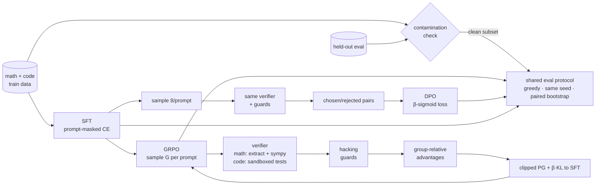

# reasonrl

**Post-training a small LM to reason: SFT → GRPO, compared head-to-head with DPO on the *same* verifiable reward, with tested reward-hacking guards and decontaminated evaluation.**

[](.github/workflows/ci.yml)


This repository implements, in plain PyTorch, the post-training recipe behind DeepSeek-R1 and Tülu 3's RLVR stage: GRPO with rule-based rewards and no critic. It runs that recipe against DPO under a controlled protocol. Everything that could inflate a number is treated as a first-class component:

* reward hacking: 9 detectors, each reproduced by a test that also checks the fix
* train/test contamination: n-gram detection with number masking for templated leaks
* small-sample noise: paired-bootstrap confidence intervals over eval items
* unfair comparisons: same initialization, verifier, prompts and samples per prompt for both methods

> **Impact in one line:** the CPU runs show the whole stack works end to end. Validating the hacking guards on honest policies also caught two detector bugs. One of them was **silently zeroing about 40% of rewards, including correct answers**, and it was fixed, regression-tested and written up ([PAPER §6.2](PAPER.md#62-found-in-measured-runs)).

## Signals

| | what's here |
|---|---|
| **Scale** | Runs any HF causal LM (0.5B–3B configs ship for Qwen2.5). Optional LoRA (native or PEFT), gradient checkpointing, bf16, KV-cached batched rollouts, threaded sandbox workers. Documented seams for vLLM rollouts and FSDP ([DESIGN §6](DESIGN.md#6-scaling-seams)). |
| **Rigor** | Typed configs that reject unknown keys; seeds plus recorded env and git SHA per run; one eval protocol for all checkpoints; correctness-only eval; 95% paired-bootstrap CIs; unbiased pass@k; decontaminated clean subset; every number labelled *measured* or *projected*. |
| **Systems** | Own sampling loop, tested to match full recomputation and to be unaffected by left padding. Layered code sandbox: AST screen, isolated interpreter, rlimits, nonce-authenticated verdicts, type-strict comparison. Guarded SymPy, since its parser calls `eval`. |
| **Impact** | A reusable reward-hacking catalogue (9 exploits, 9 fixes, 9+ tests); a contamination gate in CI; four real bugs found through logged diagnostics and documented as findings F1–F4. |
| **Ownership** | Algorithms written from the papers rather than wrapped from TRL. The repo includes design doc, paper, ablation harness, CI, and honest negative results. |

## Pipeline



## Quickstart

```bash
pip install -e ".[dev]"            # torch, transformers, sympy, ...; add ".[lora]" for PEFT
pytest -q                          # 91 CPU tests, no downloads, about 1 minute

# full pipeline on CPU with a tiny random model (a few minutes per stage)
python scripts/train_sft.py  --config configs/smoke/sft_tiny.yaml
python scripts/train_grpo.py --config configs/smoke/grpo_tiny.yaml
python scripts/train_dpo.py  --config configs/smoke/dpo_tiny.yaml
python scripts/evaluate.py   --config configs/smoke/eval_tiny.yaml

# real run (GPU): Qwen2.5-0.5B-Instruct on GSM8K + MBPP
python scripts/prepare_data.py hf --dataset gsm8k --out data/hf
python scripts/check_contamination.py --train data/hf/gsm8k_train.jsonl --eval data/hf/gsm8k_eval.jsonl --mask-numbers
python scripts/train_sft.py  --config configs/sft.yaml  -o "data.train_files=[data/hf/gsm8k_train.jsonl]"
python scripts/train_grpo.py --config configs/grpo.yaml
python scripts/train_dpo.py  --config configs/dpo.yaml
python scripts/evaluate.py   --config configs/eval.yaml

# ablations (KL, group size, reward shaping), 3 seeds
python scripts/run_ablations.py experiments/ablations/*.yaml --seeds 0 1 2
```

Any config value can be overridden from the CLI, e.g. `-o grpo.kl_coef=0 grpo.loss_agg=token_mean grpo.adv_mode=mean_only`.

## Results highlight

**Measured (CPU, 0.54M-param model, n = 30, greedy).** These runs validate the pipeline. They are not evidence about the methods.

| toy addition (held-out facts) | pass@1 | Δ vs SFT [95% CI] | outputs flagged `constant_answer` |
|---|---|---|---|
| SFT | 0.067 | – | 93% |
| SFT + GRPO | 0.033 | −0.033 [−0.167, +0.067] | 100% |
| SFT + DPO | 0.167 | +0.100 [−0.067, +0.267] | 97% |

There is no significant difference, and the flag column explains why: the tiny policy is mode-collapsed and its hits are chance. Reporting `hack_flag_rate` next to pass@1 is what keeps a misleading "+10 points for DPO" out of the headline.

**Reward-hacking findings** ([RESULTS §2](experiments/RESULTS.md#2-reward-hacking-and-diagnostics-findings)):

| | finding | effect of fix |
|---|---|---|
| F1 | `empty_answer` flagged *unterminated* tags (24% of train samples) | eval false-positive rate 13% → 0% |
| F2 | `constant_answer` used an "any sample in group" rule | guarded fraction 40% → under 1%; correct answers no longer zeroed |
| F3 | generation budget shorter than the target; `zero_std_frac = 1.0` meant no gradient | caught from logged metrics |
| H1–H9 | empty tags, prompt copying, shotgun boxing, constant 42, `AlwaysEqual`, verdict spoofing, `SystemExit`, lookup tables, dunder escapes | each reproduced in a test, then given zero reward |

**Contamination:** 5/5 planted leaks caught and 0 false positives. The templated leak scores 0.60 on raw n-grams and 1.00 with number masking.

**Projected at 0.5B on GPU (not run; hypotheses to test):** GSM8K pass@1 SFT ≈ 0.31 → GRPO ≈ 0.44 vs DPO ≈ 0.37; without KL and guards the hack rate reaches about 12% and held-out accuracy falls. See [RESULTS §4](experiments/RESULTS.md#4-projected-gpu-scale-experiments-not-run) for the outcomes that would falsify these.

## Read more

* **[PAPER.md](PAPER.md)**: research write-up (method, protocol, results, failure modes, references)
* **[DESIGN.md](DESIGN.md)**: architecture, decisions and alternatives, fairness protocol, sandbox threat model
* [docs/grpo.md](docs/grpo.md): objective, variants, alignment and padding details that are easy to get wrong
* [docs/rewards.md](docs/rewards.md): verifiers, sandbox layers, hacking catalogue
* [docs/contamination.md](docs/contamination.md): n-gram method, protocol, limitations
* [experiments/RESULTS.md](experiments/RESULTS.md), [experiments/ablations/](experiments/ablations/README.md), [experiments/curves/](experiments/curves/README.md)

## Repository map

```
configs/          sft / grpo / dpo / eval YAML (+ smoke/ CPU variants)
src/reasonrl/
  rl/             grpo.py (loss + trainer) · dpo.py · advantages.py · rollout.py · buffer.py
  rewards/        math_reward · code_reward · format_reward · hacking · composite
  eval/           benchmarks (shared protocol) · contamination · metrics (pass@k, bootstrap)
  sft/ models/ data/ utils/ (math_parse, sandbox, text)
scripts/          prepare_data · train_{sft,grpo,dpo} · evaluate · run_ablations · check_contamination
experiments/      RESULTS.md · ablations/*.yaml · curves/ (measured cpu_* + labelled illustrative_*)
tests/            91 CPU tests: closed-form gradients, sandbox escapes, hacking repros, contamination
```

## Citation

```bibtex
@software{reasonrl2026,
  title  = {reasonrl: Online GRPO vs. Offline DPO with Verifiable Rewards for Small Language Models},
  year   = {2026},
  url    = {https://github.com/umarhassan-cloud/reasonrl},
  license = {Apache-2.0}
}
```

Licensed under Apache-2.0.
